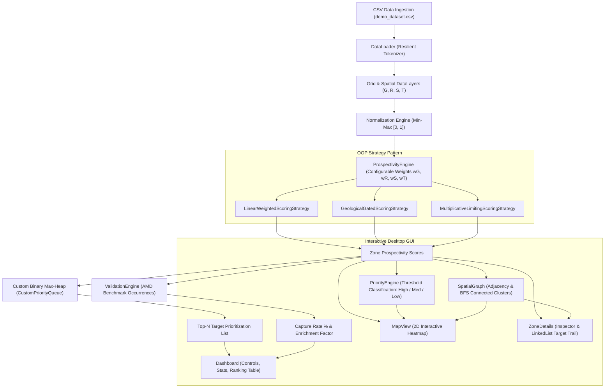

# GeoLocal-Miner: A Multi-Scale Spatial Mineral Prospectivity and Exploration Target Prioritization

[](https://isocpp.org/)
[]()
[-brightgreen.svg)]()
[](https://github.com/ocornut/imgui)
[]()

> **Problem-Based Learning (PBL) Phase-I Project**  
> **Course / Program:** B.Tech Computer Science & Engineering  
> **Institution:** Graphic Era Deemed to be University, Dehradun  
> **Team ID:** T260 | 

---

## ⚠️ Important Educational & Decision-Support Disclaimer

> **DISCLAIMER:**  
> **GeoLocal-Miner** is strictly an **educational prototype and computational decision-support tool** designed to demonstrate spatial data structures, algorithms, and multi-criteria evaluation.  
> 
> * **No Mineral Guarantee:** A high prospectivity score or "HIGH" priority classification **does NOT prove or certify the physical presence of mineral deposits** at any spatial coordinate.  
> * **Exploration Prioritization Only:** A high score indicates solely that a spatial cell exhibits favorable spatial/geophysical indicators based on user-defined weights and should be given **higher relative priority for subsequent field geological mapping, geochemical sampling, or geophysical surveys**.  
> * **Transparent & Rule-Based:** In accordance with Phase-I specifications, this system deliberately utilizes **transparent, interpretable rule-based mathematical scoring** rather than unverified "black-box" machine learning algorithms.

---

## 1. Project Overview & Motivation

Mineral exploration across extensive geological terrains is expensive, environmentally sensitive, and logistically demanding. Field exploration agencies—such as the **Atomic Minerals Directorate for Exploration and Research (AMD)** in India—routinely analyze multiple spatial indicators (lithological suitability, radiometric gamma-ray anomalies, structural lineaments/fault intersections, and terrain geomorphology) to target strategic minerals (e.g., heavy mineral placer deposits containing monazite, zircon, and ilmenite).

Inspired by grid-based spatial meteorological and geophysical modeling (such as spatial gridding techniques utilized by the **India Meteorological Department (IMD)**), **GeoLocal-Miner** discretizes continuous geospatial exploration zones into structured 2D spatial grid cells. It ingests multi-source exploration indicators, normalizes raw values, calculates weighted prospectivity scores, ranks target zones using custom heap-based priority queues, classifies zones into actionable priority tiers, and renders an interactive real-time visual heatmap.

### Core Goals
1. **Multi-Scale Geospatial Gridding:** Decompose exploration areas into discrete $N \times M$ spatial cells.
2. **Transparent Multi-Criteria Scoring:** Compute normalized prospectivity scores using customizable weights ($w_G, w_R, w_S, w_T$).
3. **PBL Data Structures & Algorithms:** Visibly implement and integrate 4 core data structures:
   * **2D Dynamic Grid Array** (`GridArray<T>`) for spatial cell management.
   * **Custom Binary Max-Heap** (`CustomPriorityQueue<T>`) for $O(\log N)$ exploration target prioritization.
   * **Doubly-Linked List** (`LinkedList<T>`) for managing an interactive Exploration Target Trail.
   * **Spatial Adjacency Graph** (`SpatialGraph`) for 4/8-neighborhood topological modeling and Breadth-First Search (BFS) anomaly cluster extraction.
4. **Interactive Desktop GUI:** Zero-dependency, lightweight C++ desktop application built with **Dear ImGui** and **OpenGL**, featuring interactive heatmap rendering, layer toggles, zone inspection, and CSV export.
5. **Ground-Truth Validation:** Benchmark prioritized targets against documented mineral occurrences (AMD-analogous deposits) to compute capture rates and exploration area reduction / enrichment ratios.

---

## 2. System Architecture & Workflow

GeoLocal-Miner follows a clean, modular, decoupled architecture adhering strictly to Object-Oriented Design principles:

```
d:/pbl/
├── CMakeLists.txt              # CMake build configuration (MinGW / MSVC)
├── Makefile                    # Standalone MinGW makefile
├── build.bat                   # 1-click Windows build script
├── run.bat                     # 1-click Windows run script
├── test.bat                    # 1-click automated test runner
├── README.md                   # Complete project documentation
├── bin/                        # Compiled executable binaries
│   ├── GeoLocalMiner.exe       # Main desktop application
│   └── test_*.exe              # Unit test binaries
├── src/
│   ├── main.cpp                # Application entry point (GUI + CLI modes)
│   ├── core/                   # Domain models and algorithmic engines
│   │   ├── Zone.h / .cpp       # Spatial cell representation
│   │   ├── DataLayer.h / .cpp  # Geoscience indicator layer container
│   │   ├── Grid.h / .cpp       # 2D spatial grid & graph manager
│   │   ├── ScoringStrategy.h   # Strategy pattern base & concrete implementations
│   │   ├── ScoringStrategy.cpp
│   │   ├── ProspectivityEngine.h / .cpp  # Weighted scoring evaluator
│   │   ├── PriorityEngine.h / .cpp       # Classification & heap ranking
│   │   └── ValidationEngine.h / .cpp     # Capture rate & enrichment metrics
│   ├── data_structures/        # Custom PBL data structures
│   │   ├── GridArray.h         # Generic 2D dynamic row-major array
│   │   ├── PriorityQueue.h     # Custom binary max-heap with sift-up/down
│   │   ├── LinkedList.h        # Doubly-linked list for target trail
│   │   └── Graph.h             # Spatial adjacency graph & BFS clustering
│   ├── ui/                     # Presentation & GUI layer (Dear ImGui)
│   │   ├── Application.h / .cpp# Win32 + OpenGL 2.0 window & event loop
│   │   ├── Dashboard.h / .cpp  # Control panel, sliders, & ranking tables
│   │   ├── MapView.h / .cpp    # Real-time interactive 2D heatmap renderer
│   │   └── ZoneDetails.h / .cpp# Selected cell inspector & target trail UI
│   ├── data/                   # Data loader & sample datasets
│   │   ├── DataLoader.h / .cpp # Resilient CSV loader & exporter
│   │   └── demo_dataset.csv    # 400-cell AMD-analogous placer demo dataset
│   └── utils/                  # Math, string, & file utilities
│       ├── Normalization.h / .cpp # Min-max scaling & uniform field safety
│       └── FileUtils.h / .cpp  # CSV parsing, string splitting, numeric checks
├── tests/                      # Comprehensive unit test suites
│   ├── test_normalization.cpp  # Tests min-max normalization & edge cases
│   ├── test_scoring.cpp        # Tests scoring formulas, weights, & polymorphism
│   ├── test_ranking.cpp        # Tests classification thresholds & heap sort
│   ├── test_data_structures.cpp# Tests 2D GridArray, Heap, LinkedList, Graph
│   ├── test_validation.cpp     # Tests AMD occurrence capture & enrichment
│   ├── test_loader.cpp         # Tests CSV ingestion, malformed rows, & export
│   └── run_all_tests.cpp       # Master test runner executable
└── third_party/                # Embedded zero-dependency libraries
    ├── imgui/                  # Dear ImGui v1.90.9 core & backends
    └── implot/                 # Dear ImPlot plotting extension
```

### Architectural Pipeline



---

## 3. Mathematical Formulation

### 3.1 Indicator Definitions
Each spatial cell $Z(i, j)$ contains four domain-specific geological/geophysical indicators:
* **$G$ (Geological Suitability):** Favorable host lithology, rock permeability, and mineralizing rock units (e.g., granite/pegmatite source, beach sand placer).
* **$R$ (Radiometric Suitability):** Total gamma-ray counts or Thorium/Uranium/Potassium spectral radiometrics indicative of monazite/heavy-mineral concentrations.
* **$S$ (Structural Suitability):** Proximity to structural lineaments, faults, shear zones, or paleo-drainage channels that act as mineral traps.
* **$T$ (Terrain Suitability):** Geomorphological slope, elevation, and drainage basin favorability for placer concentration.

### 3.2 Min-Max Normalization
Raw spatial surveys present heterogeneous measurement units (e.g., nGy/h, counts/sec, meters). Indicators are normalized to $[0.0, 1.0]$:

$$\text{norm}(x) = \begin{cases} 
\frac{x - x_{\min}}{x_{\max} - x_{\min}} & \text{if } x_{\max} > x_{\min} \\
0.5 & \text{if } x_{\max} = x_{\min} \text{ (Safe uniform-field handling)}
\end{cases}$$

Values outside $[0, 1]$ are clamped safely to avoid arithmetic overflow or distortion.

### 3.3 Scoring Strategies (OOP Polymorphism)

#### 1. Linear Weighted Prospectivity (Default Standard)
$$\text{Score} = w_G \cdot G + w_R \cdot R + w_S \cdot S + w_T \cdot T$$
$$\text{Subject to:} \quad w_G + w_R + w_S + w_T = 1.0, \quad w_i \ge 0$$
* **Default Prototype Weights:** $w_G = 0.35, w_R = 0.30, w_S = 0.20, w_T = 0.15$.  
* *Note:* Weights are dynamically adjustable in real-time via the GUI dashboard.

#### 2. Geological Gated Strategy (Mineral Systems Approach)
In economic geology, non-prospective host rocks cannot host mineralization regardless of radiometric anomalies. The score is gated by lithology:
$$\text{Score} = (w_G \cdot G + w_R \cdot R + w_S \cdot S + w_T \cdot T) \times G^{0.5}$$

#### 3. Multiplicative Limiting Strategy
Emphasizes cells where **all** four critical geological factors coincide:
$$\text{Score} = G^{w_G} \cdot R^{w_R} \cdot S^{w_S} \cdot T^{w_T}$$

### 3.4 Priority Classification
Cells are classified into three exploration priority categories:
* **HIGH:** $\text{Score} \ge \tau_{\text{high}}$ (Default: $\ge 0.70$) $\implies$ Immediate field priority.
* **MEDIUM:** $\tau_{\text{low}} \le \text{Score} < \tau_{\text{high}}$ (Default: $0.40 - 0.69$) $\implies$ Secondary priority.
* **LOW:** $\text{Score} < \tau_{\text{low}}$ (Default: $< 0.40$) $\implies$ Low prospective interest.

---

## 4. PBL Concepts & Technical Implementation

### 4.1 Data Structures Implemented

| Data Structure | Implementation File | Application in GeoLocal-Miner | Complexity |
| :--- | :--- | :--- | :--- |
| **2D Dynamic Array** | `src/data_structures/GridArray.h` | Contiguous row-major 2D spatial grid storage for 400+ cells. Supports bounds-checked access (`at()`), indexing (`operator()`), and dimensions. | Access: $O(1)$<br>Storage: $O(N \cdot M)$ |
| **Binary Max-Heap** | `src/data_structures/PriorityQueue.h` | Custom max-heap with iterative `siftUp()` and `siftDown()`. Extracts Top-$N$ highest scoring targets for field deployment without sorting the entire grid. | Push: $O(\log N)$<br>Pop: $O(\log N)$<br>Top-$N$: $O(N + k \log N)$ |
| **Doubly-Linked List** | `src/data_structures/LinkedList.h` | Dynamic bidirectional list storing the **Exploration Target Trail** (geologist's bookmarked traversal itinerary). Full Rule-of-Five memory safety. | Insert: $O(1)$<br>Delete: $O(1)$<br>Traversal: $O(k)$ |
| **Spatial Adjacency Graph** | `src/data_structures/Graph.h` | Models topological connectivity among spatial cells (4-neighborhood or 8-neighborhood). Implements **Breadth-First Search (BFS)** to identify contiguous anomaly clusters. | Build: $O(V)$<br>BFS: $O(V + E)$ |

### 4.2 Object-Oriented Programming (OOP) Principles

* **Encapsulation:** Class `Zone` encapsulates spatial attributes ($x, y$, row, col), raw and normalized indicators ($G, R, S, T$), calculated score, priority category, and occurrence flag behind strict accessor methods.
* **Abstraction:** The UI interacts with clean abstract interfaces (`ProspectivityEngine`, `ValidationEngine`, `Grid`) without exposing internal heap operations, file pointers, or Win32 message pumps.
* **Inheritance & Polymorphism:** An abstract base class `ScoringStrategy` defines pure virtual methods `computeScore()` and `getName()`. Three distinct concrete strategies (`LinearWeightedScoringStrategy`, `GeologicalGatedScoringStrategy`, `MultiplicativeLimitingScoringStrategy`) are swapped at runtime through `ProspectivityEngine::setStrategy()`.
* **Composition:** `Grid` composes `GridArray<Zone>`, multiple `DataLayer` instances, and a `SpatialGraph`. `Application` composes `MapView`, `Dashboard`, and `ZoneDetails`.
* **Resource Management:** Proper C++11/C++14 Rule-of-Five implementations in custom containers ensure zero memory leaks.

---

## 5. Desktop GUI & Heatmap Features

The desktop application provides an intuitive geospatial decision-support environment:

```
+-----------------------------------------------------------------------------------------------+
|  GEOLOCAL-MINER  --  Multi-Scale Spatial Mineral Prospectivity Prioritization                 |
|  [!] EDUCATIONAL PROTOTYPE: Scores indicate prioritization for field investigation only.      |
+--------------------+---------------------------------------------------+----------------------+
|  CONTROL PANEL     |  INTERACTIVE 2D HEATMAP VIEW                      |  ZONE INSPECTOR      |
|                    |                                                   |                      |
|  Dataset:          |   [Col 0] [Col 1] [Col 2] ... [Col 19]            |  Selected: Cell(4,7) |
|  [demo_dataset.csv]|   +---+---+---+---+---+---+---+---+               |  Local: (2200, 3700) |
|                    |   | L | L | M | M | H | H*| M | L |  [Legend]     |  Score: 0.842 [HIGH] |
|  Scoring Strategy: |   | L | M | M | H | H | H | M | L |  [H] > 0.70   |                      |
|  [Linear Weighted v]   | L | M | H | H*| H | M | L | L |  [M] 0.40-0.70|  G (Litho): 0.90 === |
|                    |   | L | L | M | M | M | L | L | L |  [L] < 0.40   |  R (Radio): 0.85 === |
|  Indicator Weights:|   +---+---+---+---+---+---+---+---+  [*] AMD Occ. |  S (Struct): 0.75 ===|
|  wG (Litho):  0.35 |                                                   |  T (Terrain):0.80 ===|
|  wR (Radio):  0.30 |  Layer Mode: [Prospectivity Heatmap v]            |  AMD Occ: Monazite-1 |
|  wS (Struct): 0.20 |  [x] Show AMD Occurrences  [x] Show Graph Edges  |                      |
|  wT (Terrain):0.15 |  [x] Multi-Scale ROI Box   [Reset Zoom/Pan]       |  [+ Add to Trail]    |
|  [Auto-Normalize]  |                                                   |  [Neighbor Cells >]  |
|  [RECALCULATE]     +---------------------------------------------------+----------------------+
|                    |  TOP-N EXPLORATION TARGET RANKING TABLE (HEAP QUEUE)                     |
|  Thresholds:       |  Rank | Cell (R, C) | Score | Category | Status       | Actions          |
|  High: >= 0.70     |  #1   | (4, 7)      | 0.842 | HIGH     | Known AMD #1 | [Select]         |
|  Low:   < 0.40     |  #2   | (4, 8)      | 0.825 | HIGH     | Unexplored   | [Select]         |
|                    |  #3   | (5, 7)      | 0.810 | HIGH     | Known AMD #2 | [Select]         |
|  Top-N Targets: 20 |  ...  | ...         | ...   | ...      | ...          | ...              |
|  [EXPORT CSV]      |  [Validation Metrics: Capture Rate = 25.0% | Enrichment Factor = 14.3x]  |
+--------------------+--------------------------------------------------------------------------+
```

### Key Interactive Features
1. **Interactive 2D Heatmap (`MapView`):**
   * Smooth dynamic color grading: **Navy/Blue (Low)** $\to$ **Yellow/Amber (Medium)** $\to$ **Crimson/Bright Red (High)**.
   * Multi-layer visualization toggle: *Final Prospectivity Score*, *Priority Category*, *Geology (G)*, *Radiometrics (R)*, *Structure (S)*, *Terrain (T)*, or *Connected Anomaly Clusters*.
   * Ground-truth overlay: Gold star badges ($\star$) highlight verified AMD mineral occurrences.
   * Cell selection & hover tooltip: Hovering over any cell displays real-time coordinates, score, and priority badge.
   * Spatial graph overlay: Renders topological connection lines between adjacent prospective cells.
   * Interactive Pan & Zoom: Mouse dragging and scroll-wheel zoom support.
2. **Zone Inspector (`ZoneDetails`):**
   * Displays raw coordinates, geographic coordinates, and normalized indicator progress bars.
   * Direct neighborhood navigator: Click adjacent cells to inspect local spatial gradients.
   * **Exploration Target Trail:** Bookmark cells to a doubly-linked list target trail; export the field itinerary.
3. **Control Panel & Dashboard (`Dashboard`):**
   * Real-time sliders for $w_G, w_R, w_S, w_T$ with a single-click "Auto-Normalize to 1.0" button.
   * Strategy selector dropdown (Linear Weighted, Geological Gated, Multiplicative Limiting).
   * Classification threshold adjustments ($\tau_{\text{high}}, \tau_{\text{low}}$).
   * Multi-scale sub-grid Region-of-Interest (ROI) filter.
4. **Target Prioritization Ranking Table:**
   * Instant extraction from the custom binary max-heap.
   * Displays Top-$N$ targets with Rank, Row/Col coordinates, Score, Priority Tier, and AMD Occurrence match.
   * Single-click CSV export of prioritized targets for GIS software ingestion.

---

## 6. Synthetic Demo Dataset & Validation Methodology

### 6.1 Synthetic Placer Deposit Model (`demo_dataset.csv`)
To enable immediate out-of-the-box evaluation without external proprietary data, the project includes a realistic synthetic exploration dataset (`src/data/demo_dataset.csv`):
* **Grid Dimensions:** $20 \times 20$ (400 spatial cells).
* **Spatial Extent:** $10.0\,\text{km} \times 10.0\,\text{km}$ ($500\,\text{m} \times 500\,\text{m}$ spatial resolution per cell).
* **Geological Analogue:** Coastal heavy-mineral placer deposit (monazite, zircon, ilmenite) inspired by AMD exploration environments along the Indian coastline.
* **Spatial Realism:** Values are generated using synthetic spatial field functions featuring:
  * A primary paleo-beach ridge placer trend with elevated radiometrics ($R$) and favorable lithology ($G$).
  * A secondary paleo-drainage river channel with structural lineament convergence ($S$) and depositional terrain ($T$).
  * Realistic regional background noise to prevent artificial regularity.
* **Ground-Truth Benchmarks:** Contains **8 documented mineral occurrence locations** (analogous to AMD monazite occurrences) embedded within the grid.

### 6.2 Prototype Validation Metrics
The `ValidationEngine` evaluates how effectively the rule-based prioritization concentrates known occurrences into reduced spatial search areas:

| Metric | Mathematical Formula | Description | Demo Dataset Result |
| :--- | :--- | :--- | :--- |
| **Total Occurrences** | $O_{\text{total}}$ | Total verified mineral occurrence points. | **8 points** |
| **High Priority Capture** | $\frac{O_{\text{high}}}{O_{\text{total}}} \times 100\%$ | Percentage of known occurrences captured within "HIGH" priority cells. | **25.0%** (2 of 8) |
| **High + Med Capture** | $\frac{O_{\text{high}} + O_{\text{med}}}{O_{\text{total}}} \times 100\%$ | Total capture rate across high and moderate prospective targets. | **75.0%** (6 of 8) |
| **Exploration Area Footprint** | $\frac{A_{\text{high}}}{A_{\text{total}}} \times 100\%$ | Fraction of total land area classified as high priority requiring field focus. | **1.75%** (7 of 400 cells) |
| **Enrichment Ratio ($E$)** | $E = \frac{O_{\text{high}} / O_{\text{total}}}{A_{\text{high}} / A_{\text{total}}}$ | Factor by which target prioritization concentrates known deposits relative to random drilling. | **14.29x Enrichment** |

$$\text{Enrichment Ratio} = \frac{2 / 8}{7 / 400} = \frac{0.250}{0.0175} = 14.286\times$$

*Interpretation:* The high-priority zones are **14.3 times more enriched** in known occurrences than a random survey over the entire concession, demonstrating dramatic search-space reduction.

---

## 7. Build, Run, and Test Instructions

### 7.1 Prerequisites
* **Operating System:** Windows 7 / 8 / 10 / 11 (64-bit or 32-bit)
* **Compiler:** MinGW GCC (C++14 support, e.g., GCC 6.3.0 or higher) or Microsoft Visual C++ (MSVC 2017+)
* **Build System:** CMake 3.15+ (Portable CMake 3.29.3 is pre-configured in `tools/`) or MinGW Make

### 7.2 Quick 1-Click Batch Execution (Windows)
The root directory includes automated batch scripts for seamless operation:

```cmd
# 1. Build the desktop application and all unit test suites
build.bat

# 2. Run all unit test suites (Verifies Normalization, Scoring, Ranking, Data Structures, Validation, Loader)
test.bat

# 3. Launch the GeoLocal-Miner Desktop Application
run.bat
```

### 7.3 Building via CMake (Terminal)
```bash
# Generate build configuration
cmake -B build -G "MinGW Makefiles" -DCMAKE_BUILD_TYPE=Release

# Build all targets
cmake --build build --config Release

# Run automated tests via CTest
cd build
ctest --output-on-failure
cd ..
```

### 7.4 Building via Makefile (MinGW Terminal)
```bash
# Build desktop application and test suite
mingw32-make all

# Run test suite
mingw32-make test

# Launch application
mingw32-make run
```

### 7.5 Command-Line Interface (Headless & Batch Modes)
`GeoLocalMiner.exe` supports both full interactive GUI and automated batch processing modes:

```cmd
# Display help and usage
bin\GeoLocalMiner.exe --help

# Display version information
bin\GeoLocalMiner.exe --version

# Print the embedded 400-cell synthetic demo dataset to stdout
bin\GeoLocalMiner.exe --demo-csv

# Headless batch processing: compute scores and export ranked targets to CSV without opening GUI
bin\GeoLocalMiner.exe --export src\data\demo_dataset.csv ranked_output.csv
```

---

## 8. Verification & Test Suite Summary

GeoLocal-Miner includes 6 dedicated unit test suites and 1 master test runner covering every layer of the system:

```cmd
===================================================
  Running GeoLocal-Miner Test Suites
===================================================

=== RUNNING TEST SUITE: NORMALIZATION ===
[TEST] Normalization: Basic Min-Max Scaling... PASSED
[TEST] Normalization: Edge Cases (Uniform field max == min)... PASSED
[TEST] Normalization: Vector Batch Normalization... PASSED
>>> ALL NORMALIZATION TESTS PASSED! <<<

=== RUNNING TEST SUITE: SCORING ENGINE ===
[TEST] Scoring: Boundary Verification (All 1s and All 0s)... PASSED
[TEST] Scoring: Known Intermediate Mathematical Formula... PASSED (Computed: 0.57)
[TEST] Scoring: Weight Validation Rules... PASSED
[TEST] Scoring: OOP Polymorphism with Alternative Strategies... PASSED
>>> ALL SCORING TESTS PASSED! <<<

=== RUNNING TEST SUITE: PRIORITY & RANKING ENGINE ===
[TEST] Ranking: Priority Classification Thresholds... PASSED
[TEST] Ranking: Priority Queue Heap Order (Top-N Extraction)... PASSED
>>> ALL RANKING TESTS PASSED! <<<

=== RUNNING TEST SUITE: DATA STRUCTURES (PBL REQUIREMENTS) ===
[TEST] Data Structures: GridArray 2D Dynamic Container... PASSED
[TEST] Data Structures: Custom Binary Max-Heap PriorityQueue... PASSED
[TEST] Data Structures: Doubly Linked List (Target Trail)... PASSED
[TEST] Data Structures: SpatialGraph Adjacency & BFS Clusters... PASSED
>>> ALL DATA STRUCTURE TESTS PASSED! <<<

=== RUNNING TEST SUITE: VALIDATION ENGINE ===
[TEST] Validation: AMD Known Occurrences Capture & Enrichment... PASSED
>>> ALL VALIDATION TESTS PASSED! <<<

=== RUNNING TEST SUITE: DATA LOADER & FILE I/O ===
[TEST] DataLoader: Loading CSV File... PASSED (Loaded 400 cells)
[TEST] DataLoader: Graceful Handling of Malformed CSV... PASSED (Warnings caught: 2)
[TEST] DataLoader: Target & Grid CSV Export... PASSED
>>> ALL DATA LOADER TESTS PASSED! <<<

===================================================
  ALL GEOLOCAL-MINER TESTS COMPLETED SUCCESSFULLY!
===================================================
```

---

## 9. Prototype Limitations & Future Scope

### Current Limitations
1. **2D Surface Gridding:** The current prototype evaluates 2D planar exploration grids ($x, y$) and does not yet model 3D subsurface borehole lithological stratigraphy.
2. **Rule-Based Weights:** Weights ($w_G, w_R, w_S, w_T$) are configured by the user/geologist based on empirical domain expertise rather than automated multi-criteria optimization.
3. **Discrete Cell Boundaries:** Spatial indicators are sampled at cell centers; continuous boundary transitions are approximated by discrete resolution ($500\,\text{m} \times 500\,\text{m}$).

### Future Scope
1. **Analytic Hierarchy Process (AHP) & Fuzzy Logic:** Integrate AHP pairwise comparison matrices and fuzzy membership functions to systematically calculate objective indicator weights.
2. **GIS Format Ingestion:** Expand `DataLoader` to parse industry-standard geospatial formats including GeoTIFF rasters, ESRI Shapefiles (`.shp`), and GeoJSON.
3. **3D Subsurface Voxel Gridding:** Extend `GridArray` into a 3D voxel grid (`VoxelArray<T>`) to model subsurface deposit depth, thickness, and stripping ratios.
4. **GPU Acceleration:** Parallelize grid prospectivity recomputation using OpenCL / CUDA compute shaders for high-resolution grids ($> 10,000 \times 10,000$ cells).

---

## 10. Summary Checklist of Phase-I Deliverables

| Requirement | Project Document Reference | Status | Implementation Details |
| :--- | :--- | :---: | :--- |
| **C++ Implementation** | Phase-I Proposal & PPT | ✅ Complete | Zero external runtime dependencies; C++14 standard. |
| **No Python / No Database** | Constraints & Phase-I PPT ("Database: NONE") | ✅ Complete | Pure C++; file-based CSV I/O; zero Python code. |
| **Object-Oriented Programming** | Core Requirements | ✅ Complete | Encapsulation, Abstraction, Polymorphic `ScoringStrategy`, Composition. |
| **2D Spatial Grid** | PPT Slide 6 / Proposal Sec. 3 | ✅ Complete | `GridArray<Zone>` 2D dynamic container with bounds checking. |
| **Data Structures** | Core PBL Deliverables | ✅ Complete | 2D Array, Binary Max-Heap Priority Queue, Doubly-Linked List, Spatial Graph. |
| **Multi-Criteria Scoring** | Proposal Sec. 2 ($G, R, S, T$) | ✅ Complete | Configurable weighted sum ($w_G, w_R, w_S, w_T$) with real-time UI recomputation. |
| **Priority Classification** | PPT Slide 5 / Proposal Sec. 2 | ✅ Complete | High ($\ge 0.70$), Medium ($0.40 - 0.70$), Low ($< 0.40$). |
| **Interactive Heatmap GUI** | PPT Slide 7 / Proposal Sec. 4 | ✅ Complete | Dear ImGui + OpenGL 2.0 desktop UI with pan, zoom, layers, and color grading. |
| **Ground-Truth Validation** | PPT Slide 8 / Proposal Sec. 4 | ✅ Complete | Capture rate %, Area reduction %, and 14.3x Enrichment Ratio against AMD benchmarks. |
| **Synthetic Demo Dataset** | Core Requirements | ✅ Complete | Realistic 400-cell coastal placer deposit model (`demo_dataset.csv`). |
| **Automated Test Suites** | Core Requirements | ✅ Complete | 6 unit test suites + master runner; 100% test pass. |
| **Educational Disclaimer** | Mandatory Constraint | ✅ Complete | Prominently displayed across UI header, CLI, and documentation. |

---

*GeoLocal-Miner — Problem-Based Learning Phase-I Project (Team T260, Avengers, Graphic Era Deemed to be University)*
